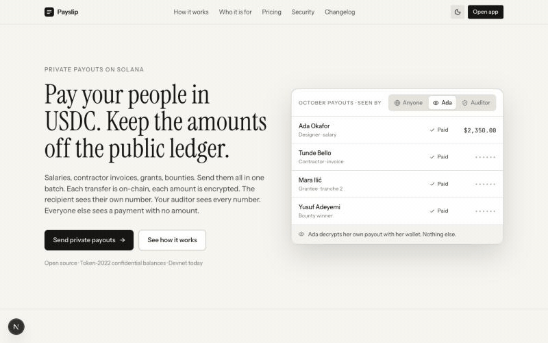

# Payslip

**Private USDC payouts on Solana.** Salaries, contractor invoices, grant
tranches and bounty prizes, sent in one batch with the amounts encrypted
on-chain. Readable only by the person who received them and the auditor the
payer designates.

> Built for Colosseum's Crypto World's Fair (September–October 2026). Not
> audited. Devnet only until the vault program has been independently reviewed and deployed to mainnet.



## The problem

Teams, DAOs and grant programs already pay people in USDC. The transfer is
instant and cheap, and every amount is public. Anyone who finds the paying
wallet can read what each person received, forever. Bounty boards and DAOs
publish every amount today because there has been no alternative. Web2 payroll
products (Deel, Remote, Rippling) cannot fix this: the transparency comes from
the chain, not from the app.

## What Payslip does

The payer keeps a roster and presses **Send payouts**. Everyone is paid in one
batch using Solana Token-2022 **confidential balances**: the transfer is
on-chain, the amount is encrypted. Each recipient decrypts only their own
amount. The payer's auditor holds a key that decrypts every transfer and spends
nothing. The explorer shows that payouts happened, and nothing else.

It is the only payout tool where the amounts are not public.

Three views of the same run:

| Who | Sees |
|---|---|
| Anyone with an explorer | Transfers between accounts. No amounts. |
| A recipient | Their own balance and statements, decrypted locally with their wallet. |
| The auditor | Every amount, recovered from the transaction signatures. Cannot move funds. |

## How it works

1. **Create a workspace.** One transaction creates the payout token: a
   Token-2022 mint with the confidential-transfer extension and the auditor's
   ElGamal public key set at creation. The mint authority is the vault program's
   PDA.
2. **Invite recipients.** Employees, contractors, grantees, bounty winners. Each
   opens a link, connects a wallet, signs once to derive their keys, and sends
   one transaction to register a confidential account for the workspace's mint.
   A roster that already lives in a spreadsheet imports from CSV in one go,
   with every row checked before anything is saved.
   For bounties and grants, where the list is not known upfront, share the
   workspace's public link instead: anyone can register, and each request is
   approved with an amount before it enters a batch.
3. **Fund the treasury.** Wrap USDC into the payout token through the vault
   (1:1, no admin), then move it to the private balance.
4. **Send a batch.** Proofs are generated in the payer's browser. Each transfer
   lands with its amount encrypted. Progress is persisted after every stage so a
   batch can be resumed without paying anyone twice.
5. **Everyone sees what they should.** Recipients confirm receipt and decrypt
   their balance. The auditor decrypts every transfer from chain and compares
   with the books. Recipients can withdraw to a visible balance and convert back
   to USDC.

See [docs/PRODUCT.md](docs/PRODUCT.md) for the product model,
[docs/ARCHITECTURE.md](docs/ARCHITECTURE.md) for the technical design,
[docs/DESIGN.md](docs/DESIGN.md) for the design system, and
[docs/BUILD_LOG.md](docs/BUILD_LOG.md) for the milestone log with PR links.

## Solana technology used

| Capability | Where |
|---|---|
| Token-2022 `ConfidentialTransferMint` with auditor ElGamal key, auto-approve | [`src/lib/solana/mint.ts`](src/lib/solana/mint.ts) |
| Confidential configure, deposit, apply, transfer, withdraw (ZK proofs in WASM, in the browser) | [`src/lib/solana/confidential.ts`](src/lib/solana/confidential.ts) |
| Auditor key derivation and per-transfer decryption from a signature | [`src/lib/solana/confidential.ts`](src/lib/solana/confidential.ts), [`src/components/auditor/Audit.tsx`](src/components/auditor/Audit.tsx) |
| Confidential transfer in one Transaction V1 (three inline proof verifications + transfer, ~2.4 KB) with multi-transaction fallback | [`src/lib/solana/confidentialV1.ts`](src/lib/solana/confidentialV1.ts), spike in [`scripts/v1-transfer-spike.ts`](scripts/v1-transfer-spike.ts) |
| Browser batch runner with persisted per-stage progress | [`src/lib/payroll/runner.ts`](src/lib/payroll/runner.ts) |
| `payslip_vault` program: USDC wrap/unwrap, vault PDA as mint authority | [`program/`](program/), client in [`src/lib/solana/vault.ts`](src/lib/solana/vault.ts) |
| Wallet-standard signing through `@solana/kit` with cached key-derivation signature | [`src/lib/solana/signers.ts`](src/lib/solana/signers.ts) |
| Sign-in with Solana (ed25519-verified session) | [`src/lib/auth/`](src/lib/auth/) |

Client libraries: `@solana/kit`, `@solana-program/token-2022`,
`@softseco/confidential-transfers` (wrapping `@solana/zk-sdk`), `@solana/react`
and wallet-standard.

## Trust model

| Party | Can see | Cannot |
|---|---|---|
| Public | That a transfer happened, sender, recipient, time | Any amount |
| Recipient | Their own balance and statements | Anyone else's amount |
| Auditor | Every transfer amount on the company mint | Spend, freeze, or move funds |
| Payslip server | Names, emails, invite links, amounts the payer typed | Keys, decrypted balances, anything the public cannot see on-chain |

Proofs and decryption run in the browser. The server never receives a key or
a decrypted amount.

## Local development

Requirements: Node 20.9+, npm. For the program: Rust, Solana CLI, Anchor 0.30.1.

```bash
cp .env.example .env.local   # set SESSION_SECRET (openssl rand -base64 32) and an RPC URL
npm install                  # also copies the zk-sdk WASM into public/zk
npm run db:push
npm run dev                  # http://localhost:3200
```

### Developer wallet (devnet)

Set `NEXT_PUBLIC_ENABLE_DEV_WALLET=true` in `.env.local` to register a
devnet-only wallet-standard wallet with four accounts, so payer, recipients and auditor
flows can be exercised in one browser without an extension. It is never
registered on mainnet. Fund its accounts with devnet SOL (the address is shown
in the account menu).

### Environment variables

Documented in [.env.example](.env.example). `NEXT_PUBLIC_VAULT_PROGRAM_ID`
switches the app from "employer wallet is mint authority" (devnet test funds)
to the vault program (USDC wrapping).

### Tests and checks

```bash
npm test            # unit tests: money, sign-in, payroll run rules
npm run typecheck
npm run lint
```

### Program

```bash
cd program
anchor build --no-idl
solana program deploy target/deploy/payslip_vault.so --program-id target/deploy/payslip_vault-keypair.json --url devnet
```

See [program/README.md](program/README.md) for the instruction set, the
invariant, and why the client is hand-written rather than IDL-generated.

## Deployment

Live on devnet: <https://payslip-sol.vercel.app>.

For the first real payout on mainnet, follow [docs/MAINNET.md](docs/MAINNET.md):
costs, a read-only preflight (`npm run preflight:mainnet`), the program deploy,
and the run itself. Every value-moving step is signed by a person.

The app targets Vercel with Turso (libsql) as the database. Set every variable
from `.env.example` in the project settings; do not set
`NEXT_PUBLIC_ENABLE_DEV_WALLET` in production.

## Repository structure

```
src/app              routes: landing, /app (employer, employee, auditor), /join, /auditor-key, /api
src/components       ui primitives, app shell, wallet, employer, employee, auditor, landing
src/lib/solana       config, rpc, signers, mint, confidential, accounts, vault, send, zk
src/lib/payroll      browser payroll runner
src/lib/auth         sign-in with Solana, sessions
src/lib/db           drizzle schema and client
src/lib/domain       pure money and payroll-run rules (tested)
src/lib/api          server helpers and typed client
program              Anchor workspace for payslip_vault
scripts              postinstall WASM copy
docs                 product model, architecture, design system, build log
```

## Status and roadmap

Working on devnet end to end: workspace creation, invites, treasury, payout
batches, recipient decrypt and withdraw, auditor decrypt and CSV export. The vault
program is deployed on devnet; payouts settle in a single Transaction V1. Next: mainnet run
with real amounts, fee sponsorship
for recipient onboarding, local off-ramps.

## License

MIT.
